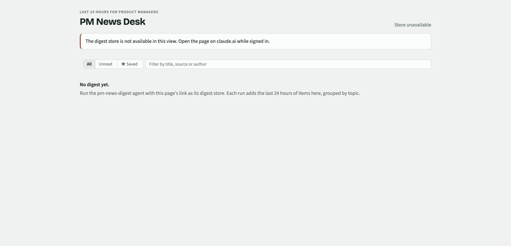

# PM News Desk

Read a product-management news digest prepared by a companion agent. Browse topics, mark stories as read and save favourites.

**Status: experimental.** Live content requires a compatible Claude artifact host and a populated news store. A regular browser shows **Store unavailable**.

## Set it up

1. Ask a compatible Claude host to create an artifact from `index.html` with `db` and `user` capabilities.
2. Open the artifact while signed in.
3. Give the [news agent](agents/pm-news-digest.md) the artifact link as **Digest store**. The agent needs the host's `ArtifactData` write tool.
4. Run one digest. Check that the run and stories appear, then open a source link to verify it.
5. Set up a recurring run through your assistant host when you are ready.

The agent gathers stories. The app reads the stored digest and saves each signed-in reader's read marks and favourites.

## Limitations and testing

- Article collection depends on reachable sources and visible publication dates.
- A digest can contain zero stories when sources are blocked or outside the selected period.
- Initial queries load up to 60 runs and 1,000 items.
- A repeat story stays linked to the first run that stored it.
- The browser's disconnected state has basic checks. Live store access, read marks, favourites and agent writes await testing.

See [testing details](docs/validation.md). Use a test artifact store for the first connected run.

## About this copy

This app comes from PM Toolkit. See [origin and license](ORIGIN.md). Google Fonts loads when internet access is available; system fonts provide a fallback.
